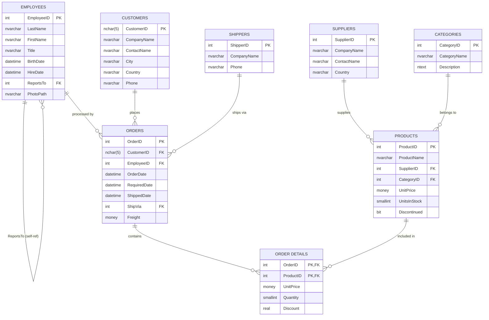

# Northwind Database - Entity Relationship Diagram

**Nguồn**: Official Microsoft sample (instnwnd.sql)  
**Domain**: Công ty kinh doanh thực phẩm cao cấp (gourmet food trading company)  
**Độ phù hợp**: Rất tốt để học relationships, DML (INSERT/UPDATE/DELETE), JOINs, và business logic.

---

## ERD (Mermaid)

---

## Các Relationship Chính (Foreign Keys)

| Từ bảng          | Đến bảng             | Loại quan hệ     | Mô tả |
|------------------|----------------------|------------------|-------|
| Employees        | Employees            | 1:N (self)       | Quản lý - nhân viên (ReportsTo) |
| Customers        | Orders               | 1:N              | Một khách hàng có nhiều đơn hàng |
| Employees        | Orders               | 1:N              | Một nhân viên xử lý nhiều đơn |
| Shippers         | Orders               | 1:N              | Một shipper vận chuyển nhiều đơn |
| Suppliers        | Products             | 1:N              | Một nhà cung cấp cung cấp nhiều sản phẩm |
| Categories       | Products             | 1:N              | Một category có nhiều sản phẩm |
| Orders           | Order Details        | 1:N              | Một đơn hàng có nhiều chi tiết |
| Products         | Order Details        | 1:N              | Một sản phẩm xuất hiện trong nhiều chi tiết đơn |

**Đặc biệt quan trọng**:
- **Order Details** là **junction table** (bảng nối) cho mối quan hệ **Many-to-Many** giữa Orders và Products.
  - Ngoài 2 khóa ngoại, nó còn chứa thêm thông tin: `UnitPrice`, `Quantity`, `Discount` (đây là điểm hay của Northwind).

---

## Số lượng bảng chính

- **8 bảng cốt lõi**: Employees, Customers, Orders, Order Details, Products, Categories, Suppliers, Shippers
- **5 bảng bổ sung** (ở phần sau của script): Region, Territories, EmployeeTerritories, CustomerDemographics, CustomerCustomerDemo

---

## Ưu điểm khi dùng để học

- Schema đã được chuẩn hóa khá tốt (đến mức 3NF).
- Có nhiều loại relationship khác nhau → luyện JOIN rất hiệu quả.
- Có sẵn dữ liệu mẫu (không quá lớn, dễ hiểu).
- Rất nhiều query thực tế có thể viết (báo cáo doanh số, top sản phẩm, hiệu suất nhân viên...).
- Phù hợp luyện **DML** (INSERT, UPDATE, DELETE) vì có nhiều bảng liên quan.

---

## Cách sử dụng trong project này

1. Tạo database `Northwind` trong SQL Server.
2. Chạy file `scripts/schemas/northwind.sql` (nên chạy trên database vừa tạo).
3. Sau đó chúng ta sẽ xây dựng thêm **fake data generator** ở `scripts/generators/` để tạo thêm dữ liệu lớn hơn.

---

**Nguồn chính thức**:  
https://github.com/microsoft/sql-server-samples/tree/master/samples/databases/northwind-pubs
